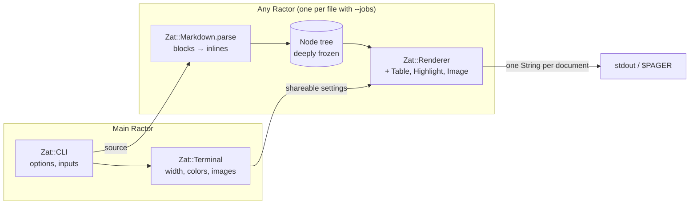

# Architecture

- **`Zat::Markdown`** is the parser. It knows nothing about terminals and requires nothing else from Zat, so it can become its own gem. `test/markdown/` runs it in isolation.
- **Only the main Ractor touches the environment** (ENV, TTY, files on stdout). Workers get frozen settings and return frozen strings. That's what makes batch mode a matter of fanning out.
- **One output buffer per document**, written once. String building is the workload under measurement, so it's kept in one place.

Why things are this way: [decisions.md](decisions.md). The plan and the issue map: [PLANNING.md](PLANNING.md).

*Update this page in the same PR as any change to the shape above.*
